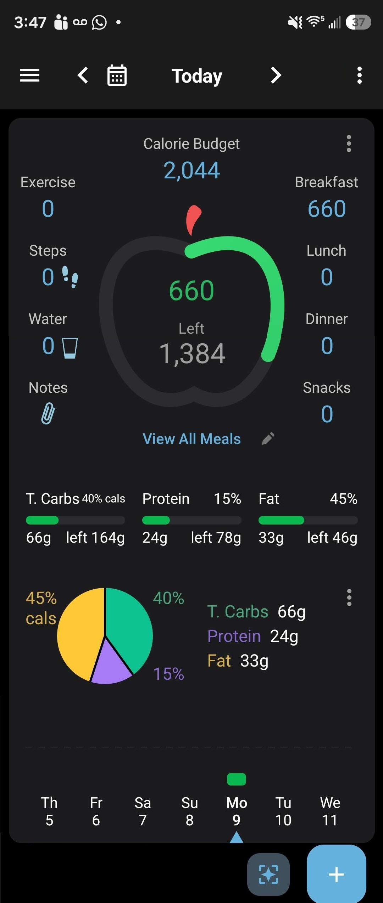

# Daily log

> Part of [Nutrition](../README.md). Overview: [SPEC.md §5.3](../../../SPEC.md#53-meals-and-the-daily-log).
> Status: **Drafting**

## Summary
The daily log (called **Diet Dashboard** in the app menu) is the main nutrition screen. It summarizes one day's nutrition (calorie budget, calories consumed and left, calories per meal, and macros consumed vs target) and is the hub that links to the more detailed nutrition screens.

- **In this subfeature:** the daily log screen, moving between days, and the links out of it.
- **Not in this subfeature:** the screens it links to, including the [Meal page](../meal-page/spec.md), [Targets](../targets/spec.md), and [Daily tracking](../../daily-tracking/README.md) (exercise, steps, water, notes). Each link opens a page stub or does nothing for now (see [Navigation](#navigation)).

## Screens

*Screenshot of the old app, used as a mockup. The layout and the information shown are binding; colors, fonts, and icons are placeholders. Where the text below differs from the image, the text wins. Differences: the pencil is not shown; the week strip is centered on the selected day and has a target dot per day.*

A single screen, top to bottom:

| # | Region | Shows |
|---|---|---|
| 1 | **Header** | Hamburger button, back arrow, day control (calendar icon and the day's label in one element), forward arrow, ⋮ menu. |
| 2 | **Calorie budget** | The day's calorie budget (see [Calories](#calories)), with a ⋮ menu at the card's top right. |
| 3 | **Apple ring** | A ring that fills as calories are consumed. The center shows calories consumed and calories **Left** (or **Over**). |
| 4 | **Meals** (right column) | Calories for each of the four meals: Breakfast, Lunch, Dinner, Snacks. |
| 5 | **Exercise, Steps, Water, Notes** (left column) | Placeholders for now: 0 for Exercise, Steps, and Water; an icon for Notes. |
| 6 | **View All Meals** | A button below the ring. (The mockup's pencil is not shown.) |
| 7 | **Macro bars** | For carbs, protein, and fat: name, target percentage, a bar of consumed vs target, grams consumed, and grams left (or over). |
| 8 | **Macro pie** | A pie of the consumed macro split, a legend of grams consumed, and a ⋮ menu. |
| 9 | **Week strip** | Seven days, each with a calorie bar and a target dot, and a dotted midway line. |
| 10 | **Scan button** (diamond) and **Add button** (+) | Float at the bottom right. |

## Behavior

### Selecting the day
- A day runs from midnight to midnight, local time ([SPEC.md §7](../../../SPEC.md#7-data-and-units)).
- The screen opens on today.
- The back and forward arrows move one day back or forward.
- Swiping anywhere on the screen works like turning a page: **swipe left** goes to the **next** day, **swipe right** goes to the **previous** day.
- Tapping the day control opens a calendar. Picking a date shows that day.
- The user can move to any past or future day. A day with nothing logged shows the [empty state](#empty-states-and-offline).
- Every day uses the same layout. Only the data changes.
- **Day label** (never includes the year):

  | Day | Label |
  |---|---|
  | Today | `Today` |
  | Yesterday | `Yesterday, Nov 9` |
  | Tomorrow | `Tomorrow, Nov 11` |
  | Any other day | `Sun, Nov 8` |

### Status colors
The ring, the macro bars, and the week strip's calorie bars use the same colors, comparing consumed with target:

| Consumed vs target | Color |
|---|---|
| Under | Green |
| Exactly on target | Yellow |
| Over | Red (the same red as the apple stem) |

"Exactly" compares the whole numbers shown on screen (kcal or g), not unrounded values. Colors are placeholders.

Calories and grams are shown as whole numbers with thousands separators (`2,044`). The ring and macro bars stop filling at full; past that, only the color and the Over text change.

### Calories
- **Calorie budget** = the day's calorie target + exercise calories ([SPEC.md §5.5](../../../SPEC.md#55-targets)).
  - Until [Targets](../targets/spec.md) is built, the calorie target is **2,000** for every day.
  - Until [Daily tracking](../../daily-tracking/README.md) is built, exercise calories are 0.
- Each **meal** shows the total calories of the entries logged in that meal. There are always four meals: Breakfast, Lunch, Dinner, Snacks ([SPEC.md §5.3](../../../SPEC.md#53-meals-and-the-daily-log)).
- **Left** = calorie budget − calories consumed. In the mockup: 2,044 − 660 = 1,384.
- When consumed is over the budget, the ring's center shows **Over** and the amount over, e.g. `Over 120`.
- The **apple ring** fills by calories consumed ÷ calorie budget, colored per [Status colors](#status-colors).

### Macros
- **Macro targets** are percentages of the calorie budget ([SPEC.md §5.5](../../../SPEC.md#55-targets)). Target grams = calorie budget × macro % ÷ kcal per gram (carbs 4, protein 4, fat 9), rounded to whole grams. Exercise raises the budget, so it raises the macro targets in proportion.
  - Until [Targets](../targets/spec.md) is built, the split is **50% carbs, 20% protein, 30% fat**. On 2,000 kcal that's 250 g, 100 g, and 67 g.
- Each **macro bar** shows:
  - the macro's name and its **target percentage** (e.g. `Carbs 50%`);
  - a bar that fills by grams consumed ÷ target grams, colored per [Status colors](#status-colors);
  - grams consumed, and **left** = target grams − grams consumed. When over, it shows **over** and the amount, e.g. `over 12g`.
- The **pie** shows the **consumed** split: each macro's calories (grams × kcal per gram) as a percent of the total macro calories. In the mockup: carbs 66 g × 4 = 264, protein 24 g × 4 = 96, fat 33 g × 9 = 297; total 657, so 40% / 15% / 45%.
- The **legend** shows grams consumed for each macro.
- Tapping the macro bars, pie, or legend does nothing.

### Week strip
- Shows seven days, with the selected day in the **center** (three days before, three after). The mockup doesn't center it; the finished app must.
- Each day has:
  - a **calorie bar**: calories consumed that day, colored per [Status colors](#status-colors) against that day's own budget. A day with nothing logged has no bar;
  - a **target dot**: that day's calorie budget. Its color shows the day type: high-intensity training day red, normal training day yellow, rest day green. Colors are placeholders.
- New days default to rest days ([SPEC.md §5.5](../../../SPEC.md#55-targets)). Until day types can be set (see [Targets](../targets/spec.md)), every day, including days with no data, shows the rest-day dot.
- Tapping a day selects it: the strip recenters on it, and the whole screen shows that day.
- Swiping left or right on the strip moves the selected day by one, in the same direction as the page swipe.
- **Size:** the chart fills the space between the pie/legend above and the day labels below, with a small margin at the top and bottom.
- **Scale:**
  - The dotted line sits at mid-height and stands for the **midway value**: the average calorie budget over the 28 days ending on the selected day.
  - The top of the chart stands for 2 × the midway value. Bars and dots are drawn in proportion; anything higher stops at the top.
  - Because the scale follows the targets, training-day targets sit above the midway line and rest-day targets below it, and the scale shifts gradually as targets change.
  - *Planned change:* scale on average calories **consumed** instead, once there's enough real data to test it. Build the scale rule so it can be swapped.

### Navigation
A **stub** is a placeholder page with a title and a way back. A **non-functional** control is displayed, but tapping it does nothing.

| Tap | Result for now |
|---|---|
| Hamburger | Opens a dropdown menu: **Diet Dashboard** (this screen), **Meals**, **Exercise**, **Weight**. Each link except Diet Dashboard opens a stub. Names are placeholders; more links will come. |
| Calorie budget | Stub for the screen that adjusts daily calorie and macro targets ([Targets](../targets/spec.md)). |
| A meal | Stub for that meal's page ([Meal page](../meal-page/spec.md)). |
| Exercise, Steps, Water, or Notes | Stub for the screen that enters that value ([Daily tracking](../../daily-tracking/README.md)). |
| View All Meals | Non-functional. Later: a screen to update all of the day's meals. |
| Any of the three ⋮ menus | Non-functional. Later: a dropdown with options such as Plan, Analyze, Customize, and Meal types. |
| Macro bars, pie, or legend | Nothing. |
| Add (+) | Stub for the screen that logs meals. |
| Scan (diamond) | Non-functional. Later: opens the camera to scan a barcode. |
| A day in the week strip | Selects that day (see [Week strip](#week-strip)). |

### Empty states and offline
- A day with nothing logged shows 0 for every meal and macro, an empty ring, and Left equal to the full budget. In the week strip it has no bar, only the rest-day target dot.
- The screen reads only local data, so it works fully offline ([SPEC.md §3](../../../SPEC.md#3-platform-and-users)).

## Definition of done
- [ ] The screen opens on today (midnight-to-midnight local) and matches the mockup's layout, with the differences listed under the mockup.
- [ ] The arrows, swiping (like turning a page), and the calendar each change the day, and every section then shows that day's data.
- [ ] Any past or future day can be shown.
- [ ] The day label matches the table in [Selecting the day](#selecting-the-day).
- [ ] Calorie budget, meals, Left/Over, and the apple ring show the values defined in [Calories](#calories), with a 2,000 kcal default target.
- [ ] Macro targets are derived from the calorie budget using the default 50/20/30 split, and the macro bars, pie, and legend show the values defined in [Macros](#macros).
- [ ] The ring, macro bars, and week-strip bars are green under, yellow exactly on target, and red over.
- [ ] The week strip keeps the selected day centered and shows each day's calorie bar and target dot on the scale defined in [Week strip](#week-strip).
- [ ] The week-strip scale rule is isolated so it can later switch to average calories consumed.
- [ ] Tapping a day in the week strip, or swiping the strip, selects a day.
- [ ] Every row in [Navigation](#navigation) behaves as listed.
- [ ] A day with nothing logged shows the empty state.
- [ ] Everything works with no network connection.

## Related open questions
None open.

## Code
_Not written yet._
